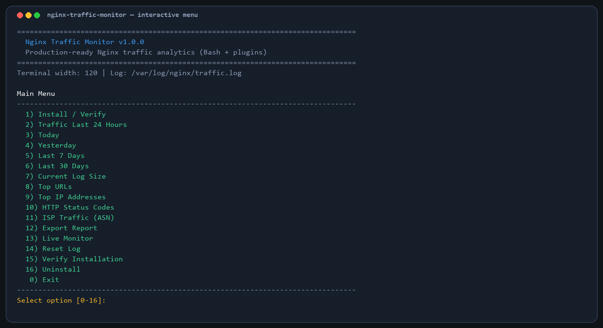
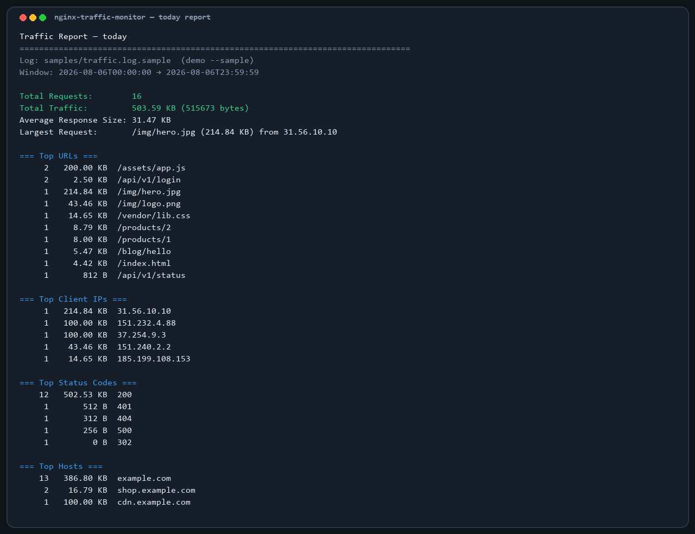
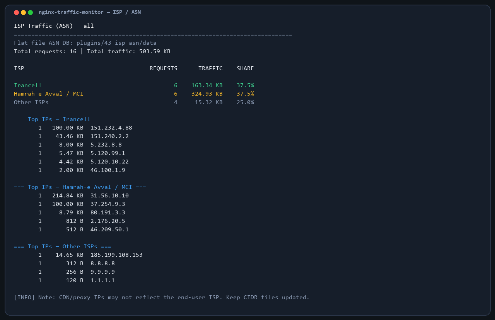
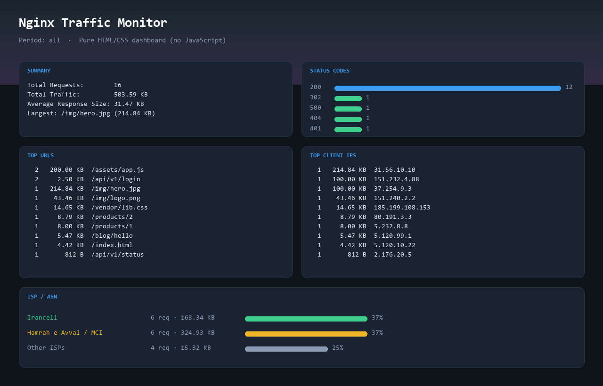
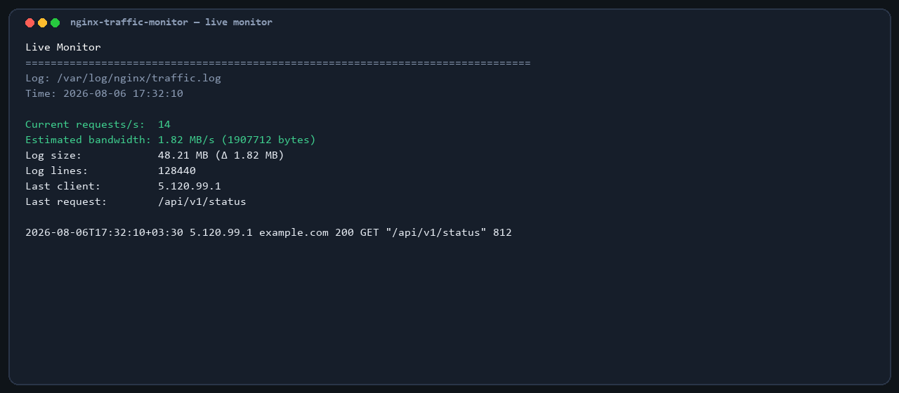

# Nginx Traffic Monitor

**Language / زبان:** [English](#nginx-traffic-monitor) · [فارسی](#nginx-traffic-monitor-فارسی)

**Repository:** [github.com/arshiyan/nginx-traffic-monitor](https://github.com/arshiyan/nginx-traffic-monitor)  
**Clone URL:** `https://github.com/arshiyan/nginx-traffic-monitor.git`

**Production-ready Bash application** for Ubuntu/Debian that installs, manages, analyzes, and reports Nginx traffic — with a **scalable plugin architecture** and **zero external runtimes**.

No Python. No PHP. No Node.js. No jq. No SQLite/MySQL.

Only: `bash`, `awk`, `grep`, `sed`, `find`, `cut`, `sort`, `uniq`, `stat`, `tail`, `wc`, `date`.

[](#)
[](LICENSE)
[](#supported-linux-distributions)
[](https://github.com/arshiyan/nginx-traffic-monitor)

---

## Quick install (from GitHub)

Download and install directly from the git repository in one command:

```bash
git clone https://github.com/arshiyan/nginx-traffic-monitor.git \
  && cd nginx-traffic-monitor \
  && sudo chmod +x install.sh traffic-monitor.sh \
  && sudo ./install.sh
```

Then open the menu:

```bash
sudo ./traffic-monitor.sh
```

Update later:

```bash
cd nginx-traffic-monitor && git pull && sudo ./install.sh --verify-only
```

---

## Project overview

Nginx Traffic Monitor configures a dedicated `log_format` named `traffic`, writes structured access logs, and provides an interactive operations menu plus a non-interactive CLI for cron and automation.

Capabilities are delivered as **plugins** under [`plugins/`](plugins/). The core stays small; new analytics (including ISP/ASN breakdown for Iranian mobile networks) ship as drop-in modules.

```
install.sh              → safe nginx wiring (backup → edit → nginx -t → reload / rollback)
traffic-monitor.sh      → menu + CLI + plugin loader
lib/                    → core engine
plugins/                → features (reports, live, export, ISP/ASN, …)
```

---

## Features

- Automatic nginx detection and `nginx.conf` discovery
- Safe install with timestamped backups and automatic rollback on `nginx -t` failure
- Structured traffic log (`time_iso8601`, IP, host, status, method, URI, bytes)
- Interactive colored menu with auto terminal width
- Period filters: today, yesterday, last 24h, 7d, 30d
- Full reports: totals, GB/TB traffic, averages, largest URL, Top 20 URLs/IPs/statuses/hosts/extensions
- Live per-second monitor (RPS, bandwidth estimate, last client/request, log growth)
- Export to **TXT** and **HTML/CSS dashboards** (no JavaScript libraries)
- Log reset via rotation (never deletes immediately)
- Clean uninstall (restore backup / remove directives)
- **Plugin system** with enable/disable, hooks, and CLI registration
- **ISP/ASN plugin**: Irancell vs Hamrah-e Avval (MCI) vs Other using flat-file CIDR DB
- Sample log for offline demos
- Optional logrotate snippet

---

## Requirements

| Required | Purpose |
|----------|---------|
| git | clone from GitHub |
| bash | runtime |
| awk, grep, sed, cut, sort, uniq | parsing & reports |
| find, stat, tail, wc, date | filesystem & time windows |
| nginx | target web server (install/verify) |
| root | only for install / reset / uninstall |

Optional soft dependency: `curl` (only for guided ASN DB update hints).

---

## Installation

### Option A — One-liner from GitHub (recommended)

```bash
git clone https://github.com/arshiyan/nginx-traffic-monitor.git \
  && cd nginx-traffic-monitor \
  && sudo chmod +x install.sh traffic-monitor.sh \
  && sudo ./install.sh
```

### Option B — Step by step

```bash
git clone https://github.com/arshiyan/nginx-traffic-monitor.git
cd nginx-traffic-monitor
sudo chmod +x install.sh traffic-monitor.sh
sudo ./install.sh
```

What the installer does:

1. Detects the nginx binary and `nginx.conf`
2. Backs up the config under `/var/backups/nginx-traffic-monitor/`
3. Ensures `log_format traffic '...'`
4. Appends `access_log /var/log/nginx/traffic.log traffic;` only when missing (no duplicates)
5. Creates the log file with proper ownership
6. Runs `nginx -t` — on failure, restores the backup
7. Reloads nginx on success

Verify only:

```bash
sudo ./install.sh --verify-only
```

---

## Usage

### Interactive menu

```bash
sudo ./traffic-monitor.sh
```

### Non-interactive CLI

```bash
# Full reports
./traffic-monitor.sh --report today
./traffic-monitor.sh --report 24h
./traffic-monitor.sh --today

# Demo without live nginx log
./traffic-monitor.sh --sample --report all

# ISP / ASN breakdown (Irancell / MCI / Other)
./traffic-monitor.sh --sample --isp-report --period all
./traffic-monitor.sh --isp-report --period today --out /tmp/isp.txt

# Export
./traffic-monitor.sh --export html --period today --out /tmp/report.html
./traffic-monitor.sh --export txt --period 7d

# Live monitor
./traffic-monitor.sh --live

# Plugins
./traffic-monitor.sh --plugins list
./traffic-monitor.sh --plugins enable hello_world
./traffic-monitor.sh --plugins disable live

# Doctor
./traffic-monitor.sh --doctor
```

---

## Menu description

| # | Action | Plugin |
|---|--------|--------|
| 1 | Install / Verify | `install_verify` |
| 2 | Traffic Last 24 Hours | `report_24h` |
| 3 | Today | `report_today` |
| 4 | Yesterday | `report_yesterday` |
| 5 | Last 7 Days | `report_7d` |
| 6 | Last 30 Days | `report_30d` |
| 7 | Current Log Size | `log_size` |
| 8 | Top URLs | `top_urls` |
| 9 | Top IP Addresses | `top_ips` |
| 10 | HTTP Status Codes | `status_codes` |
| 11 | ISP Traffic (ASN) | `isp_asn` |
| 12 | Export Report | `export` |
| 13 | Live Monitor | `live` |
| 14 | Reset Log | `reset` |
| 15 | Verify Installation | `verify` |
| 16 | Uninstall | `uninstall` |
| 0 | Exit | core |

Menu numbers come from plugin metadata and stay consistent as long as priorities are unchanged.

---

## ISP / ASN plugin

Plugin path: [`plugins/43-isp-asn/`](plugins/43-isp-asn/)

Traffic is classified using a **flat-file ASN/CIDR database** (not SQLite/MySQL):

| Group | Label | Seed ASN map |
|-------|-------|--------------|
| `irancell` | Irancell | AS44244 (+ related) |
| `mci` | Hamrah-e Avval (MCI) | AS197207 (+ related) |
| `other` | Other ISPs | everything else |

Files:

- `data/irancell.cidr`
- `data/mci.cidr`
- `data/other.cidr` (optional explicit ranges)
- `data/asn_map.conf`
- `asn_match.awk`

```bash
./traffic-monitor.sh --isp-report --period 7d
./traffic-monitor.sh --isp-update-db
```

**Notes**

- Accuracy depends on keeping CIDR files updated.
- CDN / reverse-proxy IPs may not represent the end-user ISP.
- Add a new ISP by dropping another `*.cidr` file and extending the matcher — no core changes.

---

## Plugin system

See the full guide: **[docs/PLUGINS.md](docs/PLUGINS.md)**

Highlights:

- Each feature is a folder with `plugin.conf` + `plugin.sh`
- Lifecycle hooks: `before_report`, `after_export`, `on_live_tick`, …
- Enable/disable without deleting code
- Example plugin: `plugins/examples/99-hello-world/` (disabled by default)

---

## Screenshots

> Placeholders — replace with real captures (see [docs/SCREENSHOTS.md](docs/SCREENSHOTS.md)).

| Menu | Report | ISP ASN | HTML Export | Live |
|------|--------|---------|-------------|------|
|  |  |  |  |  |

---

## Log format

```nginx
log_format traffic '$time_iso8601 $remote_addr $host $status $request_method "$request_uri" $body_bytes_sent';
access_log /var/log/nginx/traffic.log traffic;
```

---

## Configuration

Defaults live in [`config/defaults.conf`](config/defaults.conf):

- `NTM_TRAFFIC_LOG` — default `/var/log/nginx/traffic.log`
- `NTM_BACKUP_DIR` — default `/var/backups/nginx-traffic-monitor`
- `NTM_TOP_N` — default `20`
- `NTM_EXPORT_DIR` — default `/tmp/nginx-traffic-monitor`

Plugin toggles: [`config/plugins.enabled`](config/plugins.enabled)

Logrotate sample: [`share/logrotate.d/nginx-traffic-monitor`](share/logrotate.d/nginx-traffic-monitor)

```bash
sudo cp share/logrotate.d/nginx-traffic-monitor /etc/logrotate.d/
```

---

## FAQ

**Q: Can I run demos without nginx?**  
Yes. Use `--sample` to read `samples/traffic.log.sample`.

**Q: Why no database?**  
Enterprise servers often restrict extra packages. Flat files + awk keep the attack surface and ops burden minimal.

**Q: Will install break my nginx?**  
The installer always backs up first, validates with `nginx -t`, and rolls back automatically on failure.

**Q: How do I add Shatel / other ISPs?**  
Add CIDRs under `plugins/43-isp-asn/data/` and extend the awk loader / map. See [docs/PLUGINS.md](docs/PLUGINS.md).

**Q: Does live mode need root?**  
Only read access to the traffic log is required.

**Q: Is HTML export offline?**  
Yes. Pure HTML/CSS, no CDN JavaScript.

---

## Troubleshooting

| Symptom | Fix |
|---------|-----|
| `nginx binary not found` | Install nginx or set `NTM_NGINX_BIN` |
| `nginx.conf not found` | Set `NTM_NGINX_CONF=/path/to/nginx.conf` |
| `nginx -t` failed during install | Backup restored automatically; inspect the error from `nginx -t` |
| Empty reports | Confirm traffic is hitting a server block with the traffic `access_log`; wait for requests |
| Permission denied on log | Run with sudo or grant read on `/var/log/nginx/traffic.log` |
| ISP all “other” | Update `*.cidr` seeds; verify client IPs are not CDN egress |
| Plugin missing from menu | `./traffic-monitor.sh --plugins list` and enable it |

Doctor command:

```bash
./traffic-monitor.sh --doctor
```

---

## Supported Linux distributions

- Ubuntu 20.04 / 22.04 / 24.04
- Debian 11 / 12
- Compatible derivatives (Linux Mint, Pop!_OS, etc.) with standard nginx packages

Designed for POSIX-friendly Bash on systemd hosts. Other distros may work if nginx paths are set explicitly.

---

## Security notes

- Root is required only for nginx config changes, log rotation reset, and uninstall.
- Backups are stored under `/var/backups/nginx-traffic-monitor/`.
- Rotated logs are retained; reset never unlinks immediately.
- No network calls in the default analytics path.

---

## Roadmap

- [ ] More Iranian ISP profiles (Shatel, TIC, …) as data packs
- [ ] Anomaly / spike detection plugin
- [ ] Bot & abusive-IP heuristics plugin
- [ ] Cron-friendly mail/webhook notifier (optional soft deps)
- [ ] IPv6 CIDR matching
- [ ] Precomputed integer-range DB for very large logs

---

## Contributing

See [CONTRIBUTING.md](CONTRIBUTING.md) and [docs/PLUGINS.md](docs/PLUGINS.md).

Clone for development:

```bash
git clone https://github.com/arshiyan/nginx-traffic-monitor.git
cd nginx-traffic-monitor
```

---

## License

MIT — see [LICENSE](LICENSE).

---
---

# Nginx Traffic Monitor (فارسی)

**زبان / Language:** [English](#nginx-traffic-monitor) · [فارسی](#nginx-traffic-monitor-فارسی)

**ریپوزیتوری:** [github.com/arshiyan/nginx-traffic-monitor](https://github.com/arshiyan/nginx-traffic-monitor)  
**آدرس کلون:** `https://github.com/arshiyan/nginx-traffic-monitor.git`

ابزار **آمادهٔ production** با Bash خالص برای سرورهای Ubuntu/Debian که ترافیک Nginx را نصب، مدیریت، تحلیل و گزارش می‌کند — با معماری **پلاگین‌محور** و **بدون وابستگی خارجی**.

بدون Python، PHP، Node.js، jq، SQLite یا MySQL.

فقط ابزارهای استاندارد: `bash`, `awk`, `grep`, `sed`, `find`, `cut`, `sort`, `uniq`, `stat`, `tail`, `wc`, `date`.

---

## نصب سریع از GitHub

دانلود و نصب مستقیم از لینک git با یک دستور:

```bash
git clone https://github.com/arshiyan/nginx-traffic-monitor.git \
  && cd nginx-traffic-monitor \
  && sudo chmod +x install.sh traffic-monitor.sh \
  && sudo ./install.sh
```

سپس منوی تعاملی:

```bash
sudo ./traffic-monitor.sh
```

به‌روزرسانی بعدی:

```bash
cd nginx-traffic-monitor && git pull && sudo ./install.sh --verify-only
```

---

## معرفی پروژه

این برنامه یک `log_format` به نام `traffic` روی Nginx تنظیم می‌کند، لاگ ساخت‌یافته می‌نویسد و منوی عملیاتی به‌همراه CLI غیرتعاملی (مناسب cron) ارائه می‌دهد.

قابلیت‌ها به‌صورت **پلاگین** در پوشه [`plugins/`](plugins/) هستند. هسته کوچک می‌ماند و تحلیل‌های جدید (از جمله تفکیک ISP ایرانسل / همراه‌اول) به‌صورت ماژول اضافه می‌شوند.

```
install.sh              → اتصال ایمن به nginx (بکاپ → ویرایش → nginx -t → reload / rollback)
traffic-monitor.sh      → منو + CLI + بارگذاری پلاگین
lib/                    → موتور هسته
plugins/                → قابلیت‌ها (گزارش، live، export، ISP/ASN و …)
```

---

## ویژگی‌ها

- تشخیص خودکار nginx و مسیر `nginx.conf`
- نصب امن با بکاپ زمان‌دار و rollback خودکار در صورت شکست `nginx -t`
- لاگ ساخت‌یافته ترافیک (`time_iso8601`، IP، host، status، method، URI، حجم)
- منوی رنگی تعاملی با تشخیص عرض ترمینال
- فیلتر زمانی: امروز، دیروز، ۲۴ ساعت، ۷ روز، ۳۰ روز
- گزارش کامل: مجموع درخواست، ترافیک GB/TB، میانگین، بزرگ‌ترین URL، Top 20
- مانیتور زنده (RPS، پهنای باند تخمینی، آخرین کلاینت/درخواست، رشد لاگ)
- خروجی **TXT** و داشبورد **HTML/CSS** (بدون کتابخانه JavaScript)
- ریست لاگ با rotate (حذف فوری انجام نمی‌شود)
- حذف نصب تمیز (بازیابی بکاپ / حذف directiveها)
- **سیستم پلاگین** با enable/disable و هوک
- **پلاگین ISP/ASN**: ایرانسل، همراه‌اول (MCI)، سایر — با دیتابیس فایلی CIDR
- لاگ نمونه برای دمو آفلاین
- نمونه logrotate

---

## پیش‌نیازها

| مورد | کاربرد |
|------|--------|
| git | کلون از GitHub |
| bash | اجرای برنامه |
| awk, grep, sed, cut, sort, uniq | پارس و گزارش |
| find, stat, tail, wc, date | فایل‌سیستم و بازه زمانی |
| nginx | وب‌سرور هدف |
| root | فقط برای نصب / ریست / حذف |

وابستگی نرم اختیاری: `curl` (فقط راهنمای به‌روزرسانی دیتابیس ASN).

---

## نصب

### روش الف — یک خط از GitHub (پیشنهادی)

```bash
git clone https://github.com/arshiyan/nginx-traffic-monitor.git \
  && cd nginx-traffic-monitor \
  && sudo chmod +x install.sh traffic-monitor.sh \
  && sudo ./install.sh
```

### روش ب — مرحله‌به‌مرحله

```bash
git clone https://github.com/arshiyan/nginx-traffic-monitor.git
cd nginx-traffic-monitor
sudo chmod +x install.sh traffic-monitor.sh
sudo ./install.sh
```

کارهای installer:

1. پیدا کردن باینری nginx و `nginx.conf`
2. بکاپ کانفیگ در `/var/backups/nginx-traffic-monitor/`
3. اطمینان از وجود `log_format traffic`
4. افزودن `access_log` فقط اگر از قبل نباشد (بدون duplicate)
5. ساخت فایل لاگ با مالکیت مناسب
6. اجرای `nginx -t` — در صورت خطا، بازگردانی بکاپ
7. reload کردن nginx در صورت موفقیت

فقط بررسی نصب:

```bash
sudo ./install.sh --verify-only
```

---

## استفاده

### منوی تعاملی

```bash
sudo ./traffic-monitor.sh
```

### CLI غیرتعاملی

```bash
# گزارش کامل
./traffic-monitor.sh --report today
./traffic-monitor.sh --report 24h
./traffic-monitor.sh --today

# دمو بدون لاگ واقعی nginx
./traffic-monitor.sh --sample --report all

# تفکیک ISP / ASN (ایرانسل / MCI / سایر)
./traffic-monitor.sh --sample --isp-report --period all
./traffic-monitor.sh --isp-report --period today --out /tmp/isp.txt

# خروجی
./traffic-monitor.sh --export html --period today --out /tmp/report.html
./traffic-monitor.sh --export txt --period 7d

# مانیتور زنده
./traffic-monitor.sh --live

# پلاگین‌ها
./traffic-monitor.sh --plugins list
./traffic-monitor.sh --plugins enable hello_world
./traffic-monitor.sh --plugins disable live

# بررسی محیط
./traffic-monitor.sh --doctor
```

---

## توضیح منو

| # | عملیات | پلاگین |
|---|--------|--------|
| 1 | نصب / تأیید | `install_verify` |
| 2 | ترافیک ۲۴ ساعت اخیر | `report_24h` |
| 3 | امروز | `report_today` |
| 4 | دیروز | `report_yesterday` |
| 5 | ۷ روز اخیر | `report_7d` |
| 6 | ۳۰ روز اخیر | `report_30d` |
| 7 | حجم فعلی لاگ | `log_size` |
| 8 | برترین URLها | `top_urls` |
| 9 | برترین IPها | `top_ips` |
| 10 | کدهای وضعیت HTTP | `status_codes` |
| 11 | ترافیک ISP (ASN) | `isp_asn` |
| 12 | خروجی گزارش | `export` |
| 13 | مانیتور زنده | `live` |
| 14 | ریست لاگ | `reset` |
| 15 | تأیید نصب | `verify` |
| 16 | حذف نصب | `uninstall` |
| 0 | خروج | هسته |

---

## پلاگین ISP / ASN

مسیر: [`plugins/43-isp-asn/`](plugins/43-isp-asn/)

ترافیک با **دیتابیس ASN/CIDR فایلی** (نه SQLite/MySQL) دسته‌بندی می‌شود:

| گروه | برچسب | ASN اولیه |
|------|-------|-----------|
| `irancell` | ایرانسل | AS44244 (و مرتبط) |
| `mci` | همراه‌اول (MCI) | AS197207 (و مرتبط) |
| `other` | سایر ISPها | بقیه |

فایل‌ها:

- `data/irancell.cidr`
- `data/mci.cidr`
- `data/other.cidr` (اختیاری)
- `data/asn_map.conf`
- `asn_match.awk`

```bash
./traffic-monitor.sh --isp-report --period 7d
./traffic-monitor.sh --isp-update-db
```

**نکات**

- دقت وابسته به به‌روز بودن فایل‌های CIDR است.
- IPهای CDN/پروکسی ممکن است ISP واقعی کاربر نهایی نباشند.
- برای افزودن ISP جدید، فایل `*.cidr` اضافه کنید — بدون تغییر هسته.

---

## سیستم پلاگین

راهنمای کامل (انگلیسی): **[docs/PLUGINS.md](docs/PLUGINS.md)**

- هر قابلیت یک پوشه با `plugin.conf` و `plugin.sh` است
- هوک‌های چرخه حیات: `before_report`, `after_export`, `on_live_tick`, …
- فعال/غیرفعال بدون پاک کردن کد
- نمونه: `plugins/examples/99-hello-world/` (پیش‌فرض غیرفعال)

---

## فرمت لاگ

```nginx
log_format traffic '$time_iso8601 $remote_addr $host $status $request_method "$request_uri" $body_bytes_sent';
access_log /var/log/nginx/traffic.log traffic;
```

---

## تنظیمات

پیش‌فرض‌ها در [`config/defaults.conf`](config/defaults.conf):

- `NTM_TRAFFIC_LOG` — پیش‌فرض `/var/log/nginx/traffic.log`
- `NTM_BACKUP_DIR` — پیش‌فرض `/var/backups/nginx-traffic-monitor`
- `NTM_TOP_N` — پیش‌فرض `20`
- `NTM_EXPORT_DIR` — پیش‌فرض `/tmp/nginx-traffic-monitor`

فعال/غیرفعال پلاگین‌ها: [`config/plugins.enabled`](config/plugins.enabled)

نمونه logrotate: [`share/logrotate.d/nginx-traffic-monitor`](share/logrotate.d/nginx-traffic-monitor)

```bash
sudo cp share/logrotate.d/nginx-traffic-monitor /etc/logrotate.d/
```

---

## سوالات متداول (FAQ)

**آیا بدون nginx می‌توان دمو کرد؟**  
بله. با `--sample` از `samples/traffic.log.sample` استفاده کنید.

**چرا دیتابیس نیست؟**  
در سرورهای سازمانی پکیج اضافه محدود است. فایل تخت + awk سطح حمله و پیچیدگی را کم می‌کند.

**آیا نصب nginx را خراب می‌کند؟**  
اول بکاپ گرفته می‌شود، با `nginx -t` اعتبارسنجی می‌شود و در صورت خطا خودکار rollback می‌شود.

**چطور ISP دیگری مثل شاتل اضافه کنم؟**  
CIDRها را در `plugins/43-isp-asn/data/` بگذارید و matcher را گسترش دهید. جزئیات در [docs/PLUGINS.md](docs/PLUGINS.md).

**آیا live به root نیاز دارد؟**  
فقط دسترسی خواندن به لاگ ترافیک کافی است.

**آیا خروجی HTML آفلاین است؟**  
بله. فقط HTML/CSS خالص، بدون JavaScript از CDN.

---

## عیب‌یابی

| مشکل | راه حل |
|------|--------|
| `nginx binary not found` | nginx را نصب کنید یا `NTM_NGINX_BIN` را تنظیم کنید |
| `nginx.conf not found` | `NTM_NGINX_CONF=/path/to/nginx.conf` |
| شکست `nginx -t` هنگام نصب | بکاپ خودکار بازگردانی شده؛ خروجی `nginx -t` را ببینید |
| گزارش خالی | مطمئن شوید درخواست‌ها به server block دارای `access_log` ترافیک می‌رسند |
| Permission denied روی لاگ | با sudo اجرا کنید یا دسترسی خواندن بدهید |
| همه ISPها «سایر» | فایل‌های `*.cidr` را به‌روز کنید؛ IP ممکن است CDN باشد |
| پلاگین در منو نیست | `./traffic-monitor.sh --plugins list` و enable کنید |

```bash
./traffic-monitor.sh --doctor
```

---

## توزیع‌های پشتیبانی‌شده

- Ubuntu 20.04 / 22.04 / 24.04
- Debian 11 / 12
- مشتقات سازگار با پکیج استاندارد nginx

---

## امنیت

- root فقط برای تغییر کانفیگ nginx، ریست لاگ و uninstall لازم است.
- بکاپ‌ها در `/var/backups/nginx-traffic-monitor/` ذخیره می‌شوند.
- لاگ‌های rotate‌شده حفظ می‌شوند؛ ریست بلافاصله فایل را حذف نمی‌کند.
- مسیر پیش‌فرض تحلیل، درخواست شبکه ندارد.

---

## نقشه راه

- [ ] پروفایل بیشتر ISPهای ایران (شاتل، مخابرات و …)
- [ ] پلاگین تشخیص جهش/anomaly
- [ ] پلاگین فیلتر بات و IP مشکوک
- [ ] اطلاع‌رسانی cron (وابستگی نرم اختیاری)
- [ ] پشتیبانی CIDR برای IPv6
- [ ] دیتابیس رنج عددی ازپیش‌محاسبه‌شده برای لاگ‌های خیلی بزرگ

---

## مشارکت

راهنما: [CONTRIBUTING.md](CONTRIBUTING.md) و [docs/PLUGINS.md](docs/PLUGINS.md)

```bash
git clone https://github.com/arshiyan/nginx-traffic-monitor.git
cd nginx-traffic-monitor
```

---

## مجوز

MIT — جزئیات در [LICENSE](LICENSE).
